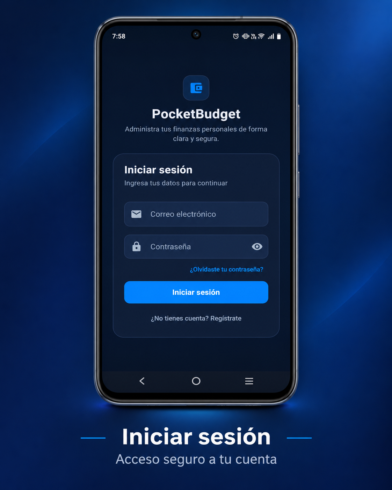
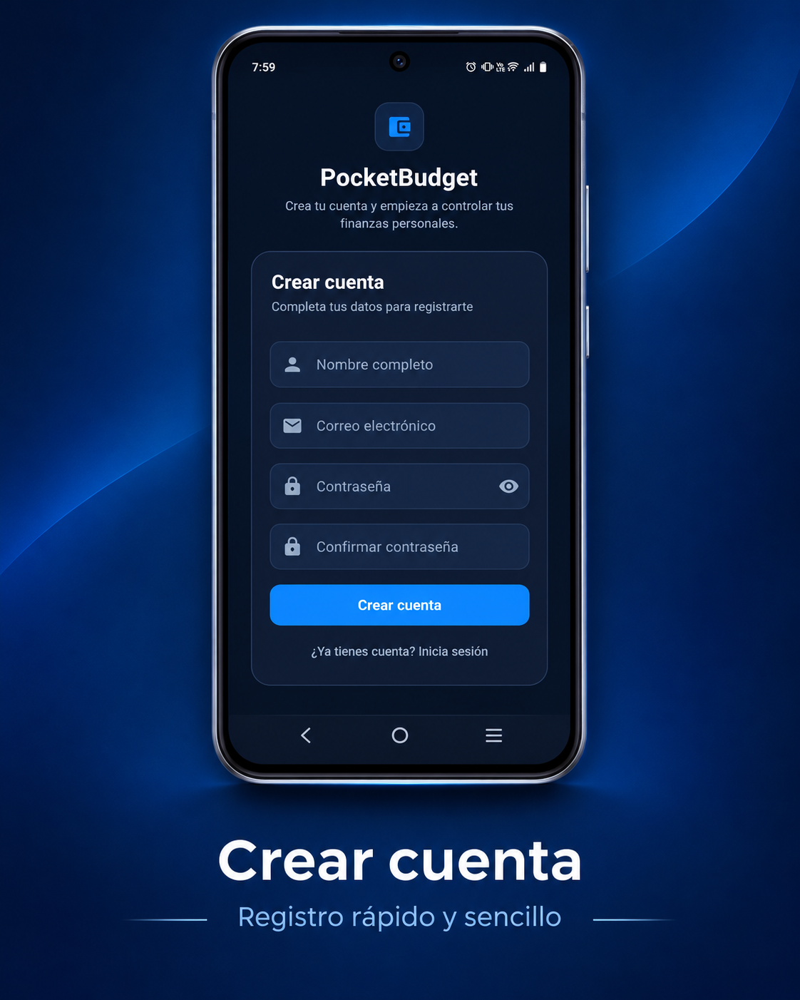
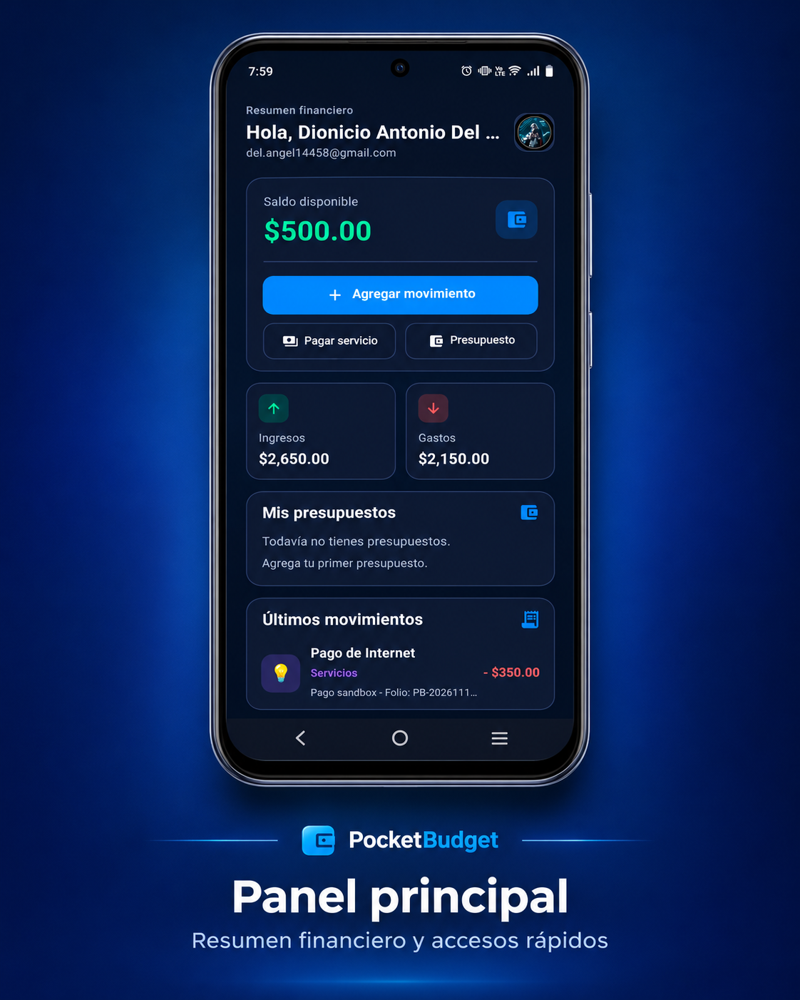
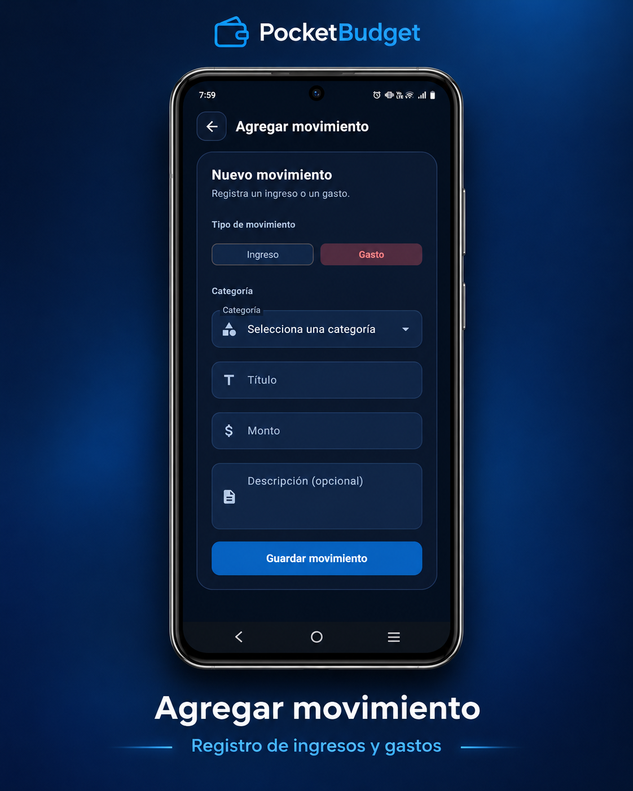
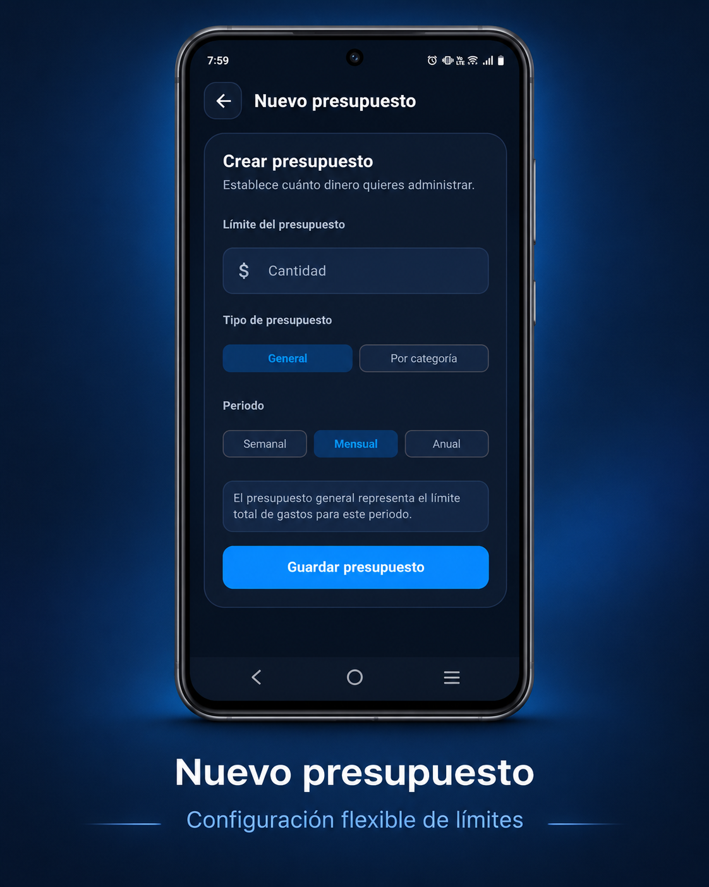
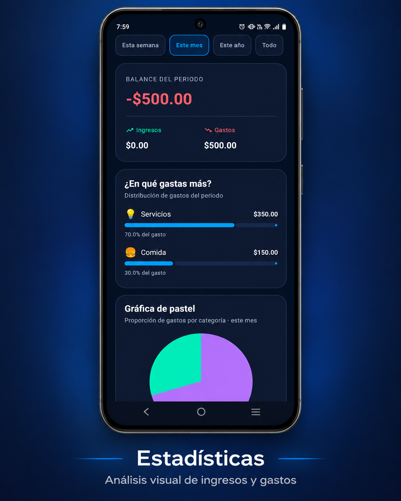
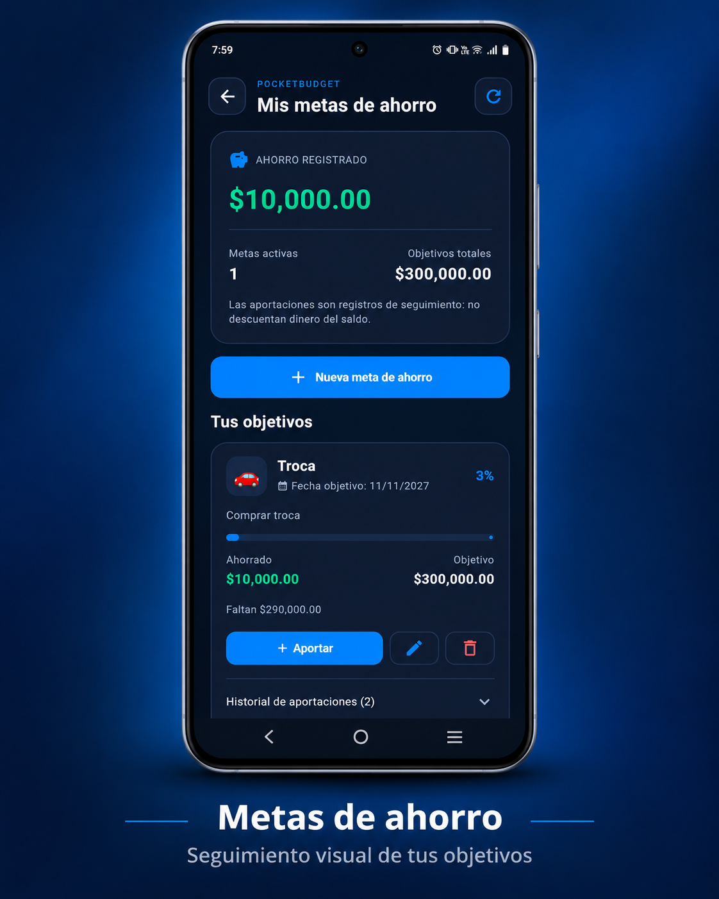

# 💙 PocketBudget Móvil

**Tu dinero, tus metas, tu control.**

PocketBudget Móvil es una aplicación nativa para Android orientada a la administración de finanzas personales. Permite registrar ingresos y gastos, organizar presupuestos, analizar movimientos y dar seguimiento a metas de ahorro mediante una interfaz moderna, intuitiva y adaptable.

Desarrollada con **Kotlin, Jetpack Compose y Supabase**.

[](https://github.com/Sergio5331/PocketBudget-Movil/releases/tag/v1.0.0)


## 📱 Descargar aplicación

**[⬇️ Descargar PocketBudget Móvil v1.0.0](https://github.com/Sergio5331/PocketBudget-Movil/releases/download/v1.0.0/PocketBudget-v1.0-release.apk)**

La APK está firmada digitalmente y fue probada en un dispositivo Android físico.

> El repositorio es privado. Para descargar la aplicación desde GitHub es necesario contar con acceso autorizado.

## ✨ Funcionalidades principales

### Panel financiero
- Consulta de saldo disponible.
- Resumen de ingresos y gastos.
- Visualización de movimientos recientes.
- Accesos rápidos a las funciones principales.

### Gestión de movimientos
- Registrar ingresos y gastos.
- Editar y eliminar movimientos.
- Organizar transacciones mediante categorías.
- Consultar el historial con búsqueda y filtros.

### Presupuestos
- Crear presupuestos generales o por categoría.
- Configurar periodos semanales, mensuales y anuales.
- Visualizar el progreso de consumo.
- Recibir avisos al alcanzar el 80 % o 100 % del límite.

### Estadísticas financieras
- Balance por periodo.
- Distribución de gastos por categoría.
- Gráfica de pastel.
- Comparación de ingresos y gastos.
- Evolución financiera de los últimos seis meses.

### Metas de ahorro
- Crear y editar objetivos personales.
- Establecer montos y fechas objetivo.
- Registrar aportaciones.
- Consultar el avance y el historial de ahorro.

### Pagos de servicios (Sandbox)
- Simular pagos de luz, agua, internet y telefonía.
- Administrar tarjetas de prueba.
- Consultar los resultados de las operaciones.

**Los pagos son exclusivamente demostrativos y no generan cargos bancarios reales.**

### Cuenta y seguridad
- Registro e inicio de sesión.
- Recuperación de contraseña.
- Edición del perfil y fotografía.
- Autenticación mediante Supabase.
- Mensajes amigables ante errores de conexión.

## 🛠️ Tecnologías utilizadas

| Tecnología | Uso |
|---|---|
| Kotlin | Lógica de la aplicación Android |
| Jetpack Compose | Interfaz de usuario |
| Android Studio | Desarrollo y compilación |
| Gradle | Dependencias y compilación |
| Supabase Auth | Autenticación |
| PostgreSQL | Persistencia de información |
| Supabase Storage | Almacenamiento de imágenes |

## 📷 Capturas de pantalla

### Inicio de sesión


### Registro de usuario


### Dashboard


### Registro de movimientos


### Presupuestos


### Estadísticas


### Metas de ahorro


## 📦 Instalación de la APK

1. Ingresa a [Releases](https://github.com/Sergio5331/PocketBudget-Movil/releases).
2. Selecciona la versión `v1.0.0`.
3. Descarga `PocketBudget-v1.0-release.apk`.
4. Abre el archivo en tu dispositivo Android.
5. Sigue las indicaciones de seguridad e instalación.
6. Abre PocketBudget e inicia sesión o crea una cuenta.

Se requiere conexión a internet para las operaciones vinculadas con Supabase.

## 💻 Ejecutar el proyecto en Android Studio

Clona el repositorio:

```bash
git clone https://github.com/Sergio5331/PocketBudget-Movil.git
```

Después:

1. Abre la carpeta del proyecto en Android Studio.
2. Espera a que Gradle sincronice las dependencias.
3. Configura los valores de conexión con tu propio entorno Supabase, según la configuración del proyecto.
4. Selecciona un emulador o dispositivo Android compatible.
5. Ejecuta el módulo `app`.

Para utilizar un backend propio, es necesario configurar el esquema, las políticas de acceso y las funciones requeridas en Supabase.

## 📁 Organización del proyecto

```text
PocketBudget-Movil/
├── app/
│   └── src/
│       └── main/
│           ├── java/
│           │   ├── com/pocketbudget/app/
│           │   ├── components/
│           │   ├── data/supabase/
│           │   ├── models/
│           │   ├── navigation/
│           │   ├── repository/
│           │   └── screens/
│           ├── res/
│           └── AndroidManifest.xml
├── docs/
├── gradle/
├── README.md
├── build.gradle.kts
└── settings.gradle.kts
```

## 🔐 Consideraciones de seguridad

- No se incluyen claves privadas de firma.
- No deben publicarse credenciales de servicio ni contraseñas.
- La información de los usuarios está sujeta a la autenticación y políticas de acceso configuradas en Supabase.
- El módulo de pagos funciona únicamente en un entorno de simulación.

## 🚀 Estado del proyecto

**PocketBudget Móvil v1.0.0 — Primera versión Release**

- Código fuente integrado en GitHub.
- Funcionalidades principales probadas.
- APK Release firmada.
- Instalación y funcionamiento comprobados en un dispositivo Android físico.

Consulta los archivos de planificación y seguimiento en la carpeta `docs/`.

---

**PocketBudget Móvil — Organiza tus finanzas, alcanza tus metas.**